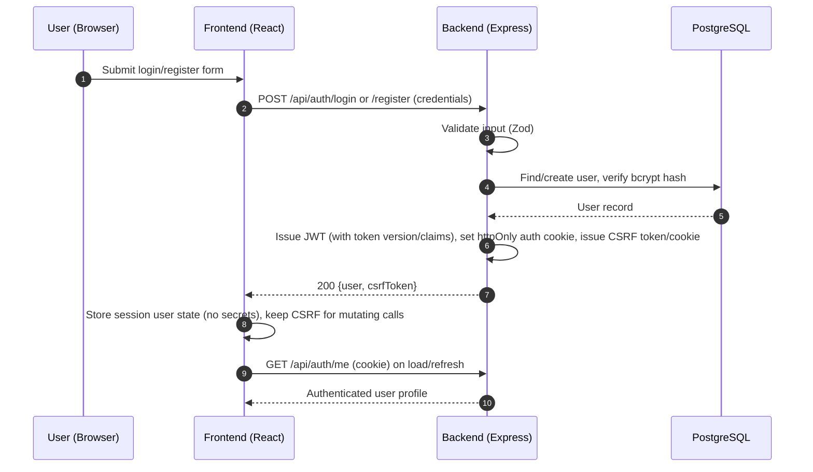
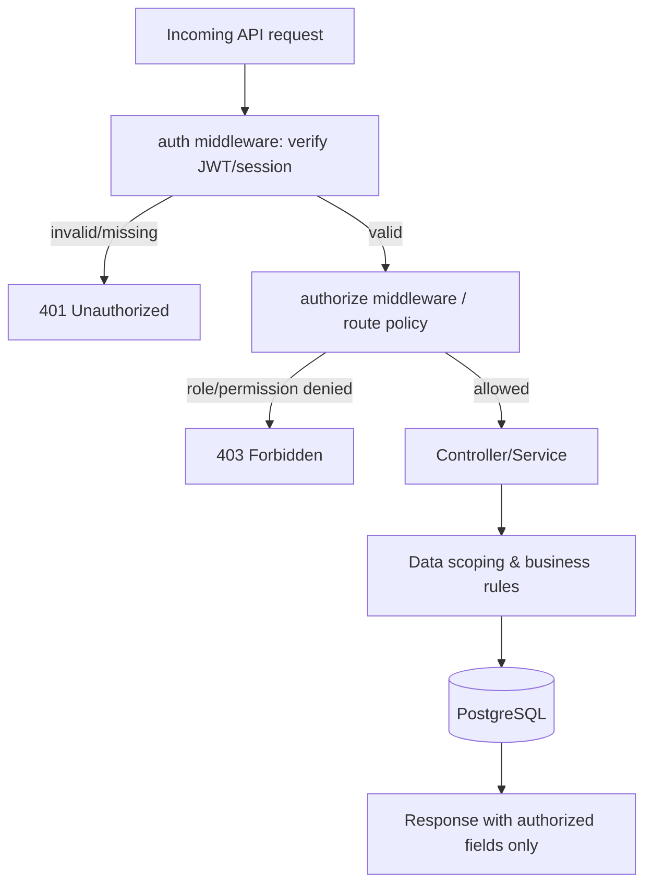
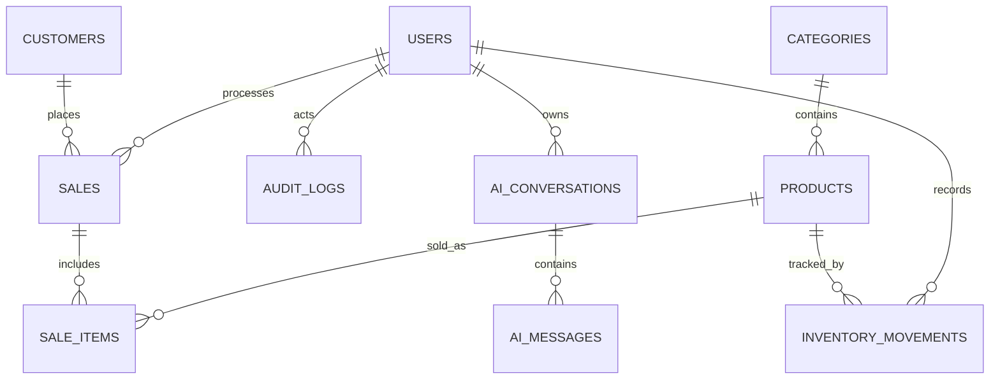
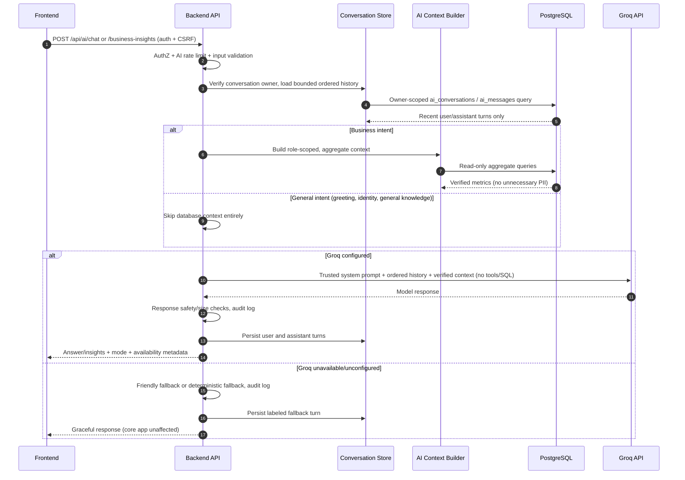
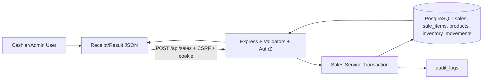

# Security Architecture - AI-Powered Motor Shop Management System

## 1. Overview
This document describes the implemented security architecture of the AI-Powered Motor Shop Management System, including frontend/backend controls, authentication and authorization flows, database and API protections, Groq AI isolation, and data flows mapped to CIA Triad enforcement.

## 2. Frontend security architecture
**Stack:** React 18, Vite 5, TypeScript, Tailwind, Axios, React Router (`frontend/`).

- **Route protection:** `frontend/src/routes/ProtectedRoute.tsx` and route composition in `frontend/src/App.tsx` gate pages by authentication and role (admin-only routes for Users, Audit Logs).
- **Auth/session state:** `frontend/src/context/AuthContext.tsx` manages current user/session state via backend-authenticated endpoints; UI does not trust client-only role checks for enforcement.
- **API client:** `frontend/src/services/api.ts` (Axios)
  - Uses `withCredentials: true` for cookie-based auth.
  - Sends `X-CSRF-Token` for mutating requests when available.
  - Handles CSRF refresh/retry logic and normalizes API errors.
  - Base URL from `VITE_API_URL` only.
- **No frontend secrets:** No `GROQ_API_KEY`, JWT secrets, or DB credentials in frontend code/env; AI requests go to backend `/api/ai/*`.
- **UX safety:** Loading/empty/error states, confirmation dialogs for destructive actions, and form validation feedback (server remains source of truth).

## 3. Backend security architecture
**Stack:** Node.js, Express 4, TypeScript (`backend/src/`).

- **Entry/middleware pipeline:** `backend/src/app.ts`, `server.ts`
  - `helmet` security headers, disabled `x-powered-by`, `Permissions-Policy`, `Cache-Control: no-store`
  - CORS with explicit origin allowlist (`FRONTEND_URL`), credentials, limited methods/headers
  - Request context/logging/timeout, JSON/body size limits
  - Cookie parsing, global rate limiting, CSRF/origin protection for state-changing API requests
  - Centralized 404 and error handling (`middleware/error-handler.ts`)
- **AuthN/AuthZ:** `middleware/auth.ts`, `middleware/authorize.ts`, `services/auth.service.ts`
  - JWT verification (cookie and/or Bearer as supported), user/token-version checks
  - Role-based authorization and ownership/scoping in services/controllers
- **Validation:** Zod schemas in `validators/*` + `middleware/validate.ts` on routes
- **Business/security services:** `services/*` implement RBAC-aware queries, transactional sales/inventory, audit logging, and AI safeguards
- **Availability controls:** `middleware/rate-limit.ts` (global/auth/AI), health controller (`/api/health`), controlled upstream failure handling

## 4. Authentication flow

**Key controls:** bcrypt hashing (`users.password_hash`), JWT secrets from env, token revocation/versioning (`users.token_version`), rate-limited auth endpoints, duplicate email prevention.

## 5. Authorization flow

**Examples enforced server-side:**
- Admin-only: `/api/users`, `/api/audit-logs`, `/api/analytics/sales`, `/api/analytics/products`, `/api/ai/business-insights`, product/category/inventory writes, sale cancellation.
- Staff: permitted product/category/customer/sales/inventory operations with scoped visibility (e.g. own sales) and restricted sensitive fields (cost/profit where applicable).

## 6. Database security and integrity design
**ORM/DB:** Drizzle ORM + PostgreSQL (`backend/src/db/schema/*`, migrations).

- **Schema protections:** UUID PKs, FK relations (`onDelete` policies), unique indexes (emails, SKU, transaction/idempotency keys), check constraints (non-negative money/stock, quantity deltas, valid totals/status rules), enums, timestamps.
- **Tables:** `users`, `customers`, `categories`, `products`, `sales`, `sale_items`, `inventory_movements`, `audit_logs`, `ai_conversations`, `ai_messages`.
- **Transactional integrity:** Sales and inventory updates executed with transactional/service logic to keep `sales`, `sale_items`, `products.stock_quantity`, and `inventory_movements` consistent; idempotency keys prevent duplicate processing.
- **Least data exposure:** Queries/services select role-appropriate fields; parameterized ORM queries reduce injection risk.
- **Migrations/seeders:** `db:generate`, `db:migrate`, `db:seed`; seeder is repeatable, env-driven, and avoids deleting existing production records.

## 7. Groq AI security architecture
**Components:** `backend/src/routes/ai.routes.ts`, `controllers/ai.controller.ts`, `services/ai.service.ts`, `services/ai-prompt.service.ts`, `services/ai-conversation.service.ts`, `services/ai-context.service.ts`, `services/groq.service.ts`.

**Controls:** backend-only `groq-sdk` (`https://api.groq.com/openai/v1`) and backend-only API key, single configured model (`GROQ_MODEL`, default `openai/gpt-oss-120b`) validated at runtime, no DB mutation/SQL execution capability (no tools registered), centralized trusted system prompt that users cannot override, bounded/role-validated history, strict owner scoping on conversation reads/writes/deletes (cross-user ids return 404), prompt/response constraints, secret-scan, PII/cost minimization in context, request timeout (`GROQ_TIMEOUT_MS`, `maxRetries: 0`) and mapped provider errors, plus graceful degradation. AI generation endpoints are rate-limited separately from conversation history endpoints so normal history use cannot exhaust the AI budget.

## 8. API protection
- **Authentication & CSRF:** JWT/cookie auth, `X-CSRF-Token` validation for state changes, origin allowlist/CORS.
- **Authorization:** per-route role checks and service-level scoping.
- **Validation:** Zod schemas for params/query/body.
- **Abuse resistance:** global/auth/AI rate limiters, body size limits, request timeouts.
- **Error handling:** centralized, consistent error envelope and safe messages; request IDs for traceability.
- **Transport/deployment:** HTTPS and secure cookie settings expected in production; reverse proxy trust configurable (`TRUST_PROXY`).

## 9. End-to-end data flow (POS example)

## 10. CIA Triad enforcement mapping
| Principle | Key mechanisms | Primary code areas |
|---|---|---|
| Confidentiality | bcrypt, JWT/cookies, CSRF, RBAC, CORS, Helmet, secret isolation, scoped data/AI context | `middleware/auth|authorize|csrf`, `services/auth|ai|groq`, `app.ts`, `frontend/src/services/api.ts` |
| Integrity | Zod validation, DB constraints/FKs/checks, transactions, idempotency, no negative stock, audit logging, AI read-only safeguards | `validators/*`, `db/schema/*`, `services/sales|inventory|ai`, `audit.service.ts` |
| Availability | Health checks, rate limiting, timeouts/limits, pooling config, centralized errors, graceful AI fallback, resilient UI states | `controllers/health.controller.ts`, `middleware/rate-limit|error-handler|request-context`, `services/groq|ai`, frontend pages |

## 11. Evidence and verification
- Automated security tests: `backend/scripts/security-tests.ts` (`npm run test:security`), results recorded in `backend/security-test-output.txt` and summarized in `docs/SECURITY-TEST-REPORT.md`.
- Automated AI tests: `backend/scripts/ai-tests.ts` (`npm run test:ai`), **19/19** passing mocked Groq error/fallback/status plus prompt/intent/conversation-validation cases.
- Live conversational E2E (Neon DB, Groq `openai/gpt-oss-120b`): **22/22** checks passed, including general-vs-business routing, real aggregate answers, contextual follow-ups, ordered history persistence, and cross-user isolation (404) / unauthenticated access (401).
- Live Groq verification (Neon DB): `/api/ai/status` reachable with model `openai/gpt-oss-120b`; `/api/ai/chat` and `/api/ai/business-insights` returned `provider: groq`, `available: true`. The full security suite was not re-run against the Groq build in this environment.
- Security control documentation and limitations: `docs/CIA-TRIAD-SECURITY.md`.

This architecture reflects the implemented system and should be updated alongside code or configuration changes. It does not constitute a formal compliance certification.
